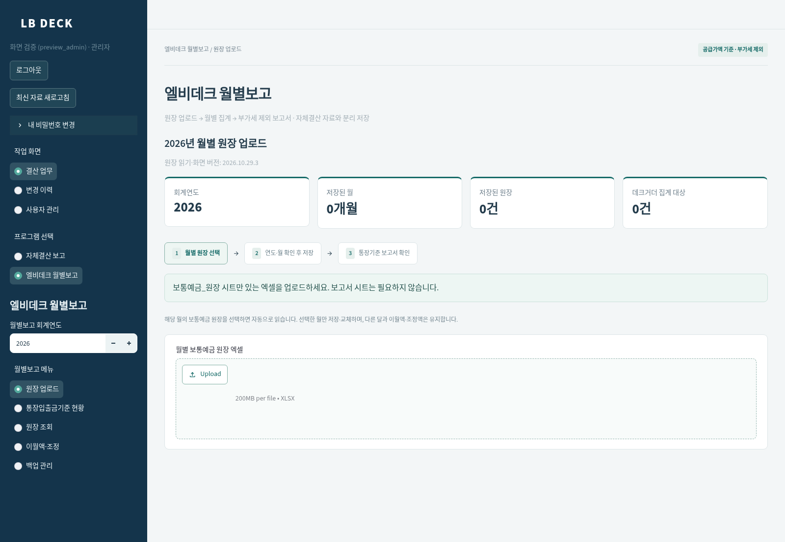
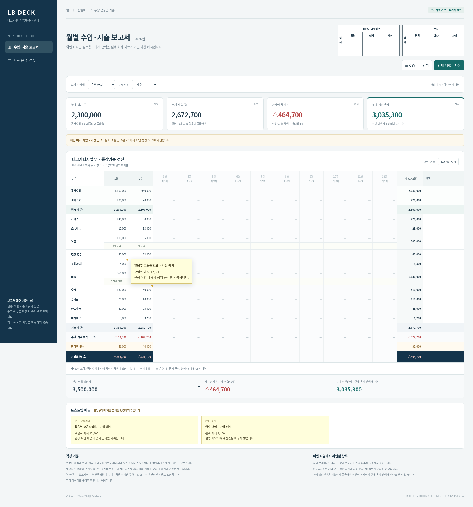
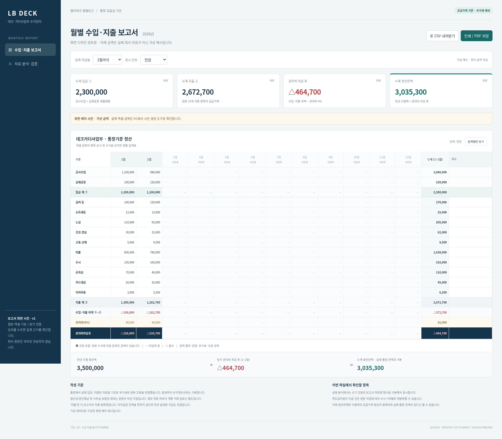
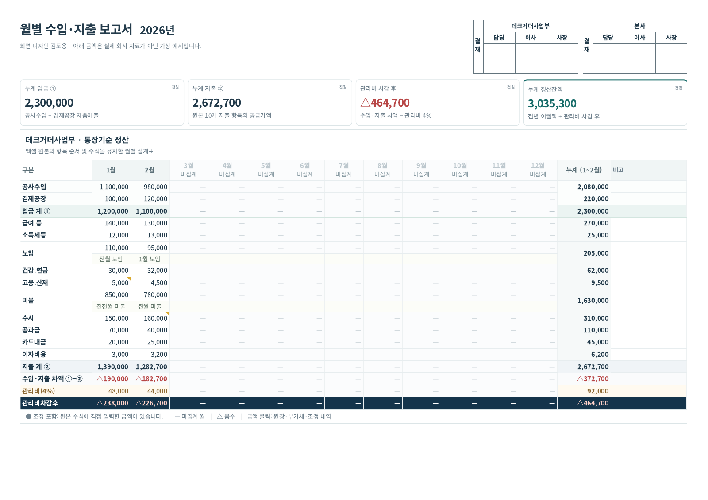
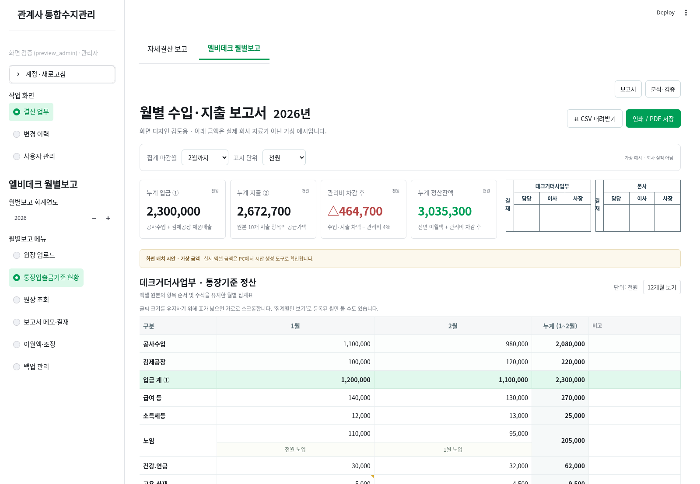

# sheri2 · 통합결산 공동 사용 업그레이드 (10명 이내)

모든 사용자가 전체 자료를 조회·입력·수정합니다. 개인별 로그인, 수정 이력,
오래된 화면의 저장 차단, 관리자 계정 관리·원장 교체·백업·복원을 추가합니다.

**이 저장소는 공개 상태이므로 회사 원본 프로그램·회계 DB·엑셀·금액이 포함된 보고서 양식을 올리지 않았습니다.**
이 저장소의 업그레이드 도구가 사용자 PC에서 기존 ZIP을 읽어 완성된 프로그램을 만듭니다.
원본 파일이나 DB를 인터넷에 업로드하지 않으며 원본 ZIP을 수정하지 않습니다.


## 기존 프로그램에서 엘비데크 월별보고 사용하기

**보통예금_원장 시트만 월별로 업로드하면 보고서가 자동 생성됩니다. 보고서 시트는 필요 없습니다.**

1. 최신 ZIP을 새 폴더에 압축 해제합니다.
2. 기존 프로그램의 실행 중인 `start.bat` 서버 창을 종료합니다.
3. 새 폴더의 **프로그램_업데이트.bat**을 실행하고 **기존 설치 폴더의 start.bat**을 선택합니다.
4. 업데이트 완료 후 **기존 폴더의 start.bat**으로 다시 실행하고 기존 계정으로 로그인합니다.
5. **프로그램 선택 → 엘비데크 월별보고 → 원장 업로드**에서 엑셀을 선택합니다.
6. 읽어 들인 연도·월과 건수를 확인하고 **선택 월 원장 저장**을 누릅니다.
7. **통장입출금기준 현황**에서 월별·누계 보고서를 확인합니다.

파일 선택창이 안 열리면 기존 `start.bat` 파일을 새 폴더의 `프로그램_업데이트.bat` 아이콘 위에 끌어다 놓아도 됩니다.
이 업데이트는 기존 `app.py`, 자체결산 DB, 계정 DB를 보존합니다. 교체 전 코드는 `private/code-updates`에 백업합니다.
최초 관리자 생성과 원본 ZIP 변환을 다시 실행할 필요가 없습니다.

업로드 화면도 보고서와 같은 네이비·청록 디자인을 사용합니다. 아래 이미지는 실제 회사 자료가 없는 임시 검증 계정으로 확인한 화면입니다.



### 결재란·월별 메모·포스트잇

**보고서 메모·결재** 메뉴에서 다음 내용을 저장합니다. 모든 사용자가 작성할 수 있고 변경 이력에 계정과 내용이 기록됩니다.

- **노임·미불 월별 메모:** 월과 항목을 선택해 귀속월 설명 등을 입력합니다. 보고서에서 해당 금액 바로 아래 별도 메모 행에 표시합니다. 빈칸으로 저장하면 삭제합니다.
- **셀 포스트잇:** 월 또는 누계와 보고서 항목을 선택하고 제목·내용을 입력합니다. 셀 모서리에 표시가 생기고, 마우스를 올리거나 금액을 눌러 내용을 확인할 수 있습니다. 제목과 내용을 모두 비우고 저장하면 삭제합니다.
- **결재란:** 데크거더사업부와 본사 각각 담당·이사·사장 칸을 출력합니다. 성명 입력 또는 수기 서명용 공란을 사용할 수 있습니다.

메모와 포스트잇은 설명 자료이며 계산값을 변경하지 않습니다. 원장에 없는 보험료를 실제 금액에 가산하려면 기존 **이월액·조정** 메뉴를 사용합니다.
메모·결재란은 월별 DB에 저장해 원장 재업로드와 프로그램 업데이트 후에도 보존합니다.
보고서 HTML/PDF에도 포함하며, 포스트잇은 인쇄 시 누락되지 않도록 보고서 하단에 모아 표시합니다. 메모가 많으면 인쇄 페이지가 늘어날 수 있습니다.
메모 기능 추가 전의 월별 백업을 복원하면 현재 메모·결재란은 유지하고 재무 자료를 복원합니다.

아래 이미지는 가상 금액으로 만든 기능 예시입니다.



### 월별 업로드·집계 규칙

- 입력 열: 날짜, 차변/입금, 대변/출금, 대분류, 중분류, VAT. 법인·프로젝트·거래처·적요·비고도 보관합니다.
- `보통예금_원장` 시트 또는 해당 머리글이 있는 단일 원장 시트를 읽습니다. 날짜를 기준으로 거래월을 결정합니다.
- 한 파일에 여러 달이 있어도 선택 월만 저장합니다. 같은 달 재업로드는 **그 달만 교체**하고 다른 달은 유지합니다.
- 보고서는 저장한 월들에서 직접 계산합니다. 업로드하지 않은 월은 —로 표시합니다.
- 입금은 공사수입·제품매출, 지출은 시안의 10개 분류를 사용합니다. 같은 월·데크거더·중분류의 입력 VAT를 차감합니다.
- 대분류에 `IF(OR(ISNUMBER(SEARCH(...)), ...), "데크거더", "0")` 같은 문자 검색 분류 수식이 있어도 읽을 수 있습니다. 지원하는 문자 분류식은 직접 계산하므로 엑셀의 저장된 계산 결과가 없어도 됩니다.
- 기타 지원하지 않는 수식은 Excel에 저장된 계산 결과가 있으면 그 값을 사용하고 사용 셀 수를 표시합니다. 계산 결과가 없는 경우 셀 주소와 전체 계산·저장 방법을 안내합니다.
- 금액 칸의 빈칸·공백·보이지 않는 주변 형식 문자는 빈 금액(0)으로 읽고 같은 행의 다른 금액은 보존합니다. 잘못된 숫자 문자열은 셀 주소와 원래 값을 표시합니다. 월별보고 업로드 화면과 왼쪽 메뉴도 보고서 시안과 같은 네이비·청록 디자인을 사용합니다. 원장 업로드 화면의 `원장 읽기·화면 버전: 2026.10.29.5`로 수정본 적용 여부를 확인할 수 있습니다.
- Excel 자체의 오류 값은 0원으로 바꾸거나 행을 건너뛰지 않고 오류를 표시합니다. 원본 수식을 바꾼 경우 Excel에서 전체 계산 후 저장하여 업로드하세요.
- 원장에는 대분류와 중분류가 입력되어 있어야 합니다. 미분류 은행 다운로드 원본을 자동 추정 분류하는 기능은 포함하지 않습니다.
- 환수는 확인 항목으로 표시하며 임의로 비용에서 빼지 않습니다.
- **이월액·조정** 메뉴에서 원장에 없는 전년 이월액, 관리비율(기본 4%), 원청 공제 보험료 보전액을 입력할 수 있습니다.
- 보험료 보전액은 해당 월 공사수입과 고용·산재에 함께 가산합니다. 월 재업로드 후에도 이 입력은 유지합니다.
- 이월액을 입력하지 않으면 월별 수지는 계산하고 최종 정산잔액은 미확인으로 표시합니다. 실제 통장잔액과 구분합니다.
- 원장 파일 교체와 백업 복원은 관리자, 보고서·원장 조회와 이월액·조정 입력은 모든 사용자가 이용합니다.

자료는 `data/lb_monthly_연도.db`에 분리 저장하며, 원본은 `private/monthly-originals`, 백업은 `private/backups`에 보관합니다.
**변경 이력**에서 월별 DB를 선택하면 업로드·조정 변경 이력을 확인할 수 있습니다.
**백업 관리**에서 연도별 월별 DB의 백업·복원을 실행합니다.
보고서 안의 월·단위·상세 기능과 HTML 다운로드를 사용할 수 있으며, 내려받은 HTML을 열어 인쇄/PDF 저장할 수 있습니다.

검증: 원장 시트만 남긴 실제 제공 파일을 월별로 저장한 뒤 별도 이월액·보험료 조정을 입력해 원본 보고서의 223개 금액을 재현했습니다.
이는 원장에 없는 조정액이 자동 추정된다는 뜻이 아닙니다. 월별 업로드만으로 계산하는 금액과 별도 입력을 구분합니다.
월별 저장·같은 달 교체·다른 달 보존·중복 저장·권한·조정 유지·충돌·백업 복원·기존 설치 보존 테스트를 포함합니다.
Windows 실제 실행과 회사 사용자 인수 확인은 별도입니다.

## 다운로드 및 Windows 설치

1. 이 페이지의 **Code → Download ZIP**을 눌러 새 폴더에 압축을 풉니다.
2. Python **3.12 (64비트)**를 설치합니다.
3. 기존 **통합결산 (3).zip**을 이 폴더에 복사하고 **upgrade.bat**을 실행합니다. 같은 폴더의 원본 ZIP을 자동으로 읽습니다. ZIP을 `upgrade.bat` 아이콘 위에 끌어다 놓아도 됩니다.
4. 변환 완료 후 **setup.bat**을 실행해 패키지를 설치하고 최초 관리자 계정을 만듭니다.
5. **start.bat**을 실행합니다. 서버 PC에서 브라우저 주소창에 `http://localhost:8501`을 입력합니다.
6. 관리자 로그인 후 **작업 화면 → 사용자 관리**에서 직원 계정을 만듭니다.
7. 직원은 같은 사내망에서 `http://서버PC사내IP:8501`에 접속합니다.

기존 파일을 덮어쓰지 않도록 새 폴더에서 시작하세요. 기존 ZIP은 최초 전달 버전만 지원합니다.
비밀번호는 12자 이상 직접 정하며 공통 초기 계정이나 비밀번호는 없습니다.
변환 과정에서는 Python 표준 라이브러리만 사용합니다. 패키지 설치 단계는 인터넷 연결이 필요합니다.

## 파일 선택창이 안 열릴 때

- 먼저 검은 창의 메시지를 확인하세요. Python 3.12가 없으면 설치 안내가 표시됩니다.
- 가장 간단한 방법은 원본 **통합결산 (3).zip**을 `upgrade.bat`과 같은 폴더에 복사한 뒤 실행하는 것입니다. 선택창이 필요하지 않습니다.
- 또는 원본 ZIP을 `upgrade.bat` 파일 아이콘 위에 끌어다 놓습니다.
- 선택창을 취소하거나 사용할 수 없는 경우에는 검은 창에 ZIP 전체 경로를 붙여 넣고 Enter를 누를 수 있습니다.
- GitHub에서 받은 ZIP은 먼저 압축을 풀어야 합니다. 원본 회사 ZIP은 압축을 풀지 않습니다.

## 대시보드에서 InvalidVersion 오류가 나는 기존 설치

`packaging.version.InvalidVersion` 오류가 발생하면 서버 창을 종료하고,
이 저장소의 **repair_dependencies.bat**을 기존 `start.bat`과 같은 폴더에 복사해 실행하세요.
기존 `.venv`의 packaging을 25.0으로 재설치하고 버전 파서 및 차트 생성을 검사합니다.
이 스크립트는 `data`와 `private` 폴더를 변경하지 않습니다.
검사 완료 후 기존 `start.bat`으로 다시 실행합니다. 업그레이드 재변환이나 관리자 재생성은 필요 없습니다.
현재 스크린샷만으로 전체 원인은 확정하지 못했으므로, 복구 뒤에도 오류가 나면 전체 traceback의 마지막 부분을 확인해야 합니다.

## 운영 조건

- 항상 켜 놓을 PC 또는 서버 **한 대**, Streamlit 서버 프로세스 **하나**를 사용합니다.
- 활성 계정은 관리자 포함 최대 10명입니다. 모든 사용자의 업무 권한은 동일합니다.
- 계정 관리, 새 연도 생성, 원장 전체 교체, 백업·복원은 관리자만 실행합니다.
- 기존 SQLite를 유지합니다. 여러 프로세스/서버 실행 및 NAS·클라우드 동기화 폴더의 DB 공유는 지원하지 않습니다.
- 같은 연도 자료가 바뀌면 다른 사용자는 저장 전 새로고침해야 합니다. 미저장 입력을 보관한 뒤 **최신 자료 새로고침**을 누르세요.
- 연도별 첫 일일 저장 전과 원장 교체 전에 백업합니다. `private/backups`에 보관합니다.
- 복원은 관리자 **결산 업무 → 데이터관리**에서 동일 버전·동일 연도 백업으로 실행합니다.
- 계정과 재무 자료 전체의 외부 백업은 서버 종료 후 `data`와 `private` 폴더를 함께 복사하세요.
- 파일 권한·디스크 용량·재부팅 후 자동 시작은 회사 운영 담당자가 관리합니다.
- 사내망에서만 접근하도록 방화벽을 설정하세요. 외부 접속에는 HTTPS 역방향 프록시 또는 회사 VPN이 필요합니다.
- 로그인은 8시간 후 만료되며, 비밀번호/계정 상태 변경 시 기존 로그인을 무효화합니다.
- 수정 이력은 이 버전에서 해당 연도 업무 화면을 처음 연 뒤부터 기록합니다. 시각은 UTC입니다.

## 검증 범위

Linux/Python 3.12에서 기능 테스트 10개를 확인했습니다. 계정·권한·10명 제한,
10개 동시 저장 요청의 충돌 차단, 수정 이력, 트랜잭션 롤백, 백업·복원,
마감 보호 및 Streamlit 화면 입력·조회·관리자 메뉴·충돌 후 새로고침을 포함합니다.
전체 실행에서 1~9번이 통과했고, 10번 테스트의 테스트 API 사용 오류를 수정한 뒤 해당 테스트를 재실행해 통과했습니다.
공개 업그레이드로 재생성한 프로그램의 해시가 검증한 전체 작업본과 일치하는지도 확인합니다.
Windows 실기기 설치, 실제 회사 서버 배포, 직원 10명의 장시간 사용 및 결산 금액 대사는 별도입니다.

회사 자료가 포함된 생성 파일은 .gitignore로 제외합니다. 원본 ZIP과 DB를 GitHub에 올리지 마세요.


## 엘비데크 월별보고 — 엑셀 분석과 보고서 시안

아래는 이전 단계의 **독립 보고서 시안 도구** 사용법입니다. 기존 프로그램 안에서 월별 업로드하려면 위의 통합 사용법을 따르세요.
기존 자체결산 프로그램과 계정·원장 DB를 변경하지 않습니다.

1. 최신 ZIP을 다운로드해 **새 폴더**에 압축을 풉니다.
2. 분석할 **통장기준정산 엑셀(.xlsx)**을 그 폴더에 복사합니다. 원본 내용을 변경하지 않습니다.
3. **월별보고_시안보기.bat**을 실행합니다. 처음에는 별도 시안 환경과 openpyxl을 설치합니다.
4. 해당 이름의 엑셀이 하나면 자동으로 읽고, 여러 개면 파일 선택창을 엽니다. 엑셀을 BAT 아이콘 위에 끌어다 놓아도 됩니다.
5. 완료되면 브라우저에서 보고서가 열립니다. 다시 보려면 `private/monthly-preview/월별보고_분석과시안.html`을 더블클릭하세요.

화면은 원본 `수입.지출(총)(부가세제외)` 시트의 항목 순서와 월별 표를 유지합니다.
마감월·원/천원/백만원 전환, 12개월/집계월 보기, 금액별 집계 근거, CSV 저장,
자료 분석·원본 대사, 인쇄/PDF 저장을 제공합니다. PDF는 A3 가로 인쇄 구성이며,
원본의 인쇄 범위 밖에 있던 이월 포함 최종 정산액도 포함합니다.
시안의 인쇄/PDF 버튼을 누른 뒤 브라우저에서 ‘PDF로 저장’을 선택할 수 있습니다.

수기 가산은 수식에서 추출하고 환수 분류는 별도 확인 항목으로 표시합니다.
원본에 없는 환수 처리나 계좌잔액을 임의로 만들지 않습니다.
미집계 월은 0원 실적과 구분해 —로 표시합니다.
표의 CSV는 표시 단위와 무관하게 원 단위 숫자를 저장합니다.

### 검증과 범위

원본 저장값을 읽는 것에 더해, 보고서가 참조하는 SUMIFS/SUM/MONTH/산술/구조화 참조를
독립 재계산해 비교합니다. 지원하지 않는 함수는 오류로 알립니다.
전체 엑셀의 모든 수식, 신고 적정성, 개별 증빙까지 검증하는 기능은 아닙니다.
보고서 작성 지침에 적힌 제외 항목은 별도 거래 검토가 필요합니다.
원장의 입력 VAT를 차감하며 일괄적으로 1.1로 나누지 않습니다.

입력된 원본 엑셀과 생성한 실제 금액·분석·보고서는 **사용자 PC의 private 폴더에만 보관**합니다.
공개 저장소에는 원본 파일이나 실제 보고서 HTML·이미지를 올리지 않습니다.
아래 이미지는 화면 배치 확인을 위한 **가상 금액** 예시입니다.



Linux Python 3.12에서 제공 워크북의 보고서 223개 셀 대사,
브라우저의 월·단위 전환, 상세 보기, CSV 생성 코드 및 A3 가로 PDF 출력을 확인했습니다.
Windows에서의 실제 실행은 별도 확인이 필요합니다.

개발자용 실행:

```bash
python monthly_report_preview.py "원본.xlsx" --output private/monthly-preview
python -m unittest discover -s tests -v
```


### 보고서 인쇄와 글씨 크기

보고서 화면은 표 본문 14px, 제목 옆 연도 26px로 표시합니다. 연간 표는 글씨를 줄이지 않고 가로 스크롤을 사용하며 ‘집계월만 보기’로 표시 월을 줄일 수 있습니다.
인쇄/PDF에서는 표 본문 11pt, 노임·미불 메모와 비고 10pt, 제목 옆 연도 18pt를 사용합니다.
사용자가 제외 요청한 **표 아래의 전년 이월·관리비 차감 후·정산잔액 요약**과 **작성 기준·확인 항목 설명**은 인쇄/PDF에서 숨깁니다.
화면에서는 해당 내용을 계속 확인할 수 있습니다. 상단 요약 카드, 결재란, 보고서 표, 노임·미불 메모, 포스트잇 메모는 출력에 포함합니다.



### 2026.10.30.1 공통 디자인

자체결산 보고와 엘비데크 월별보고, 로그인·사용자 관리에 흰 배경, 초록색 강조, 연회색 구분선과 읽기 쉬운 글씨를 공통 적용했습니다. 기존 메뉴와 집계 방식은 유지합니다. 월별 HTML 보고서에도 같은 색상을 적용했습니다. 업데이트 후 HTML은 다시 내려받으세요.

`프로그램_업데이트.bat` 실행 → Enter → **기존 설치 폴더의 start.bat** 선택 → 기존 start.bat 재실행 순서입니다.

### 2026.10.30.2 실행 화면 배치 개선

프로그램 선택을 상단으로 옮기고, 계정 도구를 접는 메뉴로 묶었습니다. 월별보고의 중복 제목·안내를 정리하고 결재란을 요약 카드 옆에 배치했습니다. 좁은 화면에서는 결재란이 다음 줄로 이동합니다. 보고서는 저장된 월을 기본 표시하며 `12개월 보기`로 전환할 수 있습니다.

아래 이미지는 생성형 디자인 시안이 아닌, 가상 자료를 넣어 실제 실행한 프로그램의 캡처입니다. 화면 배율과 창 너비에 따라 배치가 달라질 수 있습니다.


