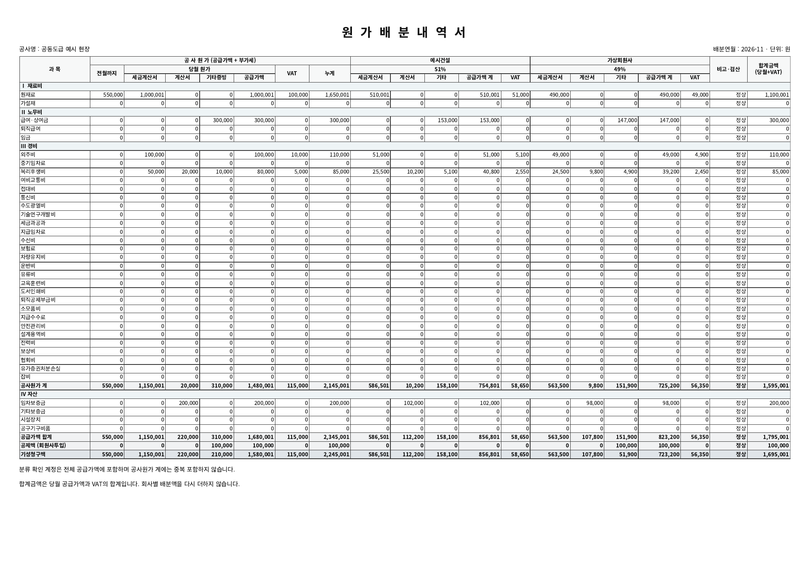
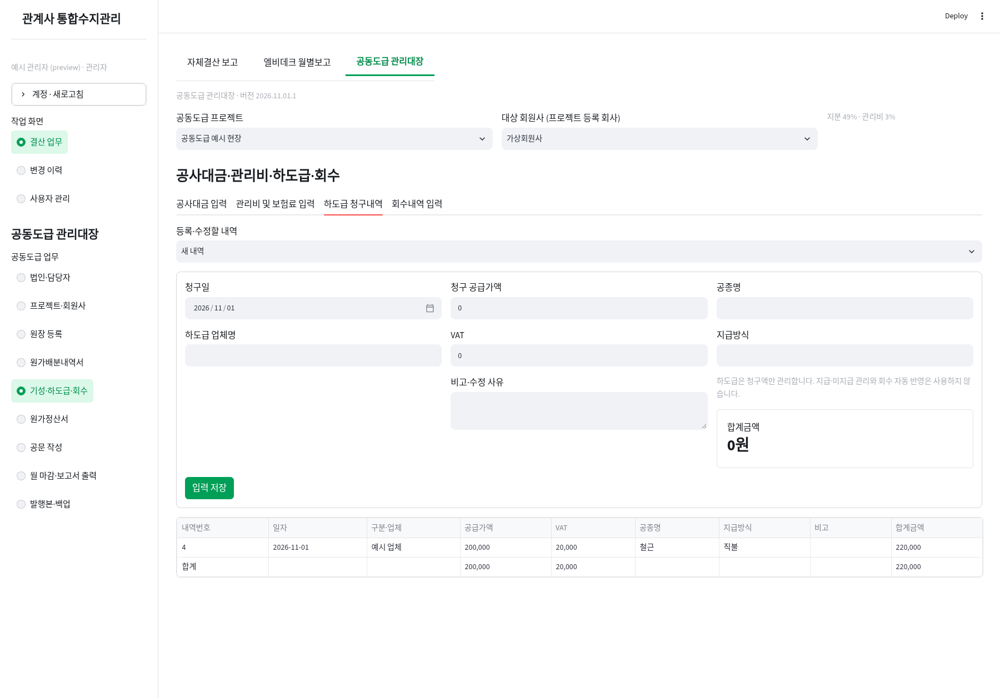

# 공동도급 관리대장 사용 안내 — 2026.10.30.3

기존 로그인·계정과 재무자료는 유지합니다. 공동도급 자료는 `data/joint_venture.db`에 별도 저장합니다. 상단 **공동도급 프로젝트 / 대상 회원사**를 선택하면 각 업무에 적용됩니다. 회원사 목록은 해당 프로젝트 등록 회사로 제한되며, 프로젝트를 바꾸면 잘못된 회원사 선택을 자동 초기화합니다.

## 1. 회사·프로젝트 등록

**법인·담당자**는 기본정보 / 연락처·계좌 / 담당자의 3열 입력 화면입니다. 회사 구분은 당사·관계사·외부 회원사이며, 이전 자료는 미분류로 표시합니다. 분류만 추가하면 기존 법인코드는 유지됩니다. 담당자 두 명의 이름·직급·연락처를 등록할 수 있습니다.

**프로젝트·회원사**에서 관리법인과 참여 회사를 선택하고 지분 합계를 100%로 맞춥니다. 관리법인은 당사·관계사(또는 아직 분류하지 않은 기존 회사)에서 선택합니다. 기존 프로젝트를 수정할 때 회원사 ID를 유지하므로 원가·정산 연결이 끊기지 않습니다. 연결 자료가 있는 회원사의 삭제, 지분율·관리비 적용 여부 변경은 구체적인 사유로 안내합니다. 공사명·계약정보·관리비 기본비율은 수정할 수 있으며 이미 발행한 문서와 마감 보관본은 바뀌지 않습니다.

## 2. 원장 입력

회원사 수기 원가는 3열 화면에 기표일자·배분연월·계정과목·거래처·적요·금액을 입력합니다. 금액은 **세금계산서 공급가액(VAT 제외), VAT, 면세 계산서, 기타영수증**으로 구분합니다. 합계 확인 후 저장할 수 있습니다.

Excel은 제목 행·마지막 자료 행과 각 열을 지정해 가져옵니다. 아마란스 실제 원본을 받기 전에는 고정 양식 자동 판독 대신 열 지정 방식으로 지원합니다. 프로젝트·투입회사·기표일자·전표번호·전표행과 파일 내용으로 중복을 막습니다. 한 행이라도 오류·중복이면 전체 파일을 저장하지 않습니다. 새 업로드부터 원본 파일도 DB에 보관해 마감 출력 묶음에서 내려받을 수 있습니다.

과거 버전에서 원본을 보관하지 않은 업로드는 원본 파일을 복원할 수 없으므로, 해당월의 저장된 원장 데이터로 출력표를 제공합니다. 원장 정정은 반대금액과 사유로 남깁니다. 새 양식 자동 배분은 계정·증빙별로 회원사 지분 금액을 INT 방식으로 계산하고 당사가 잔여액을 부담하며, 수정 시 공급가액·VAT 각각의 합계 일치를 확인합니다.

## 3. 네 입력 탭

- **공사대금 입력**: 수령일·기성 구분·공급가액·VAT를 건별로 입력합니다. 같은 기성의 분할 수령분은 같은 기성 구분을 사용합니다.
- **관리비 및 보험료 입력**: 수령 내역을 체크해 범위를 선택합니다. 같은 기성의 공급가액은 합산되며 각 기성 탭에서 보험료·제외항목·관리비율을 입력합니다. 관리비는 `(해당 기성 공급가액 − 제외합계) × 관리비율`을 **기성별 원 미만 0 방향 버림 후 합산**합니다. 보험료는 해당 회원사분으로 입력합니다. 다른 관리비 정산에 사용한 수령 건은 중복 선택할 수 없습니다.
- **하도급 청구내역**: 청구일·업체·공급가액·VAT·공종·지급방식·비고만 입력합니다. 배분연월과 지급관리 항목은 표시하지 않습니다.
- **회수내역 입력**: 실제 회수 공급가액·VAT를 수동입력합니다. 하도급 청구 금액은 회수금으로 자동 반영하지 않습니다. 실제 회수는 이 탭에 입력합니다.

기존 버전의 기성·관리비 입력은 최초 실행 시 원본을 보존한 상태로 공사대금 수령 건과 연결 관리비 정산으로 이전합니다. 이전은 한 번만 수행합니다. 이미 확정된 문서는 그대로 보존합니다.

## 4. 원가정산서 — 기간 대신 내역 선택

새 정산명을 입력하거나 저장한 정산 건을 선택하고 다음 범위를 각각 체크합니다.

1. 공사대금 수령 내역
2. 해당 수령 건에 연결된 관리비·보험료 정산
3. 원가분담금 청구 내역(배분 원장 기준). 배분월별 일괄 선택 후 개별 조정도 가능합니다.
4. 하도급 청구 내역
5. 회수 내역

수령일과 청구월이 달라도 선택할 수 있습니다. 선택만 하면 저장 없이 하단 정산서가 즉시 바뀝니다. 공사대금·관리비·회수 중 일부를 선택하지 않아도 미리볼 수 있으며, 관리비 연결 누락 등은 확인 안내로 표시합니다. 다른 정산에 이미 사용한 내역은 표시하고 중복 정산을 차단합니다. 저장 후에는 같은 정산을 다시 선택해 수정합니다.

출력물에는 시작·종료 연월 대신 정산명을 표시합니다. 가로 대장, 기성별 관리비 산출표, 하도급 청구표가 이어집니다. 미회수액 산식은 기존대로 관리비 적용 시 `수령 공급가액 − 공제계 + 청구 VAT(하도급 포함) − 회수 합계 − 회원사투입`, 미적용 시 `청구 합계 − 회수 합계`입니다.

정산에 연결된 원장·입력 내역은 정산의 선택을 먼저 해제한 뒤 수정합니다. 선택 관계 때문에 수정이 막히면 정산서의 **정산 연결 해제**에서 선택 연결만 삭제하고 입력을 수정한 뒤 정산을 다시 만드세요. 원본 입력과 과거 발행본은 삭제되지 않습니다. 관리비에 연결된 수령 건은 관리비 연결도 먼저 해제합니다. 이후 새 문서번호로 재발행하며 과거 확정본은 변하지 않습니다.

## 5. 공문

배분연월 하나로 조회합니다. 문서번호는 수동입력합니다. 제목과 인사말 사이에는 실선이 있고 접수·처리과·담당자·결재란은 삭제했습니다. 하단 상호와 대표이사는 오른쪽 정렬입니다. 직인 PNG/JPG(1MB 이하)를 선택하면 출력과 확정본에 보관합니다.

공문 금액은 `배분 공급가액 + VAT − 회원사투입 + 전월미수액 + 지연이자`입니다. 전월미수액·지연이자는 **마감 전에** 해당 배분월로 입력합니다. 공문 공제액은 회원사투입이며 정산서의 관리비·보험료 공제와 구분합니다.

## 6. 월 마감·보고서 출력

프로젝트·배분연월별로 원장과 배분을 확인한 뒤 **선택 월 마감**을 누릅니다. 미배분·배분 불일치가 있으면 마감되지 않습니다. 마감 시 해당월 원장·원가배분·회사별 공문 계산 자료를 보관합니다.

마감 후 **공문 / 해당월 원장 / 원가배분내역서** 출력 버튼과 ZIP 묶음 내려받기가 활성화됩니다. 묶음의 HTML을 열어 인쇄/PDF 저장합니다. 보관된 업로드 원본도 포함되며 원본 파일은 다른 월 자료를 함께 포함할 수 있습니다. 원장 출력표는 해당 배분월만 표시하고 업로드·수기 출처를 구분합니다.

마감된 달에는 원장 추가·배분 수정·관련 공사대금·보험료·하도급·회수·전월미수 입력의 추가/수정/삭제를 제한합니다. 관리자는 사유를 적어 마감을 해제할 수 있습니다. 해제하면 월별 출력이 다시 비활성화되며 수정 후 재마감합니다. 이전 마감 이력과 이미 발행한 문서는 보존됩니다. 원가정산서는 여러 달의 선택 내역으로 작성하므로 월별 공문·원장·배분 출력과 별도 업무입니다.

## 업데이트·보관

기존 실행 창 종료 → 새 ZIP 압축 해제 → **프로그램_업데이트.bat → Enter → 기존 설치의 start.bat 선택 → 기존 start.bat 재실행** 순서입니다. `upgrade.bat`은 최초 설치용 원본 ZIP 선택 작업입니다.

기존 계정·원본 앱·재무 DB는 유지합니다. 구조 확장과 이전 기성 자료 전환 전에 백업합니다. 변경 이력·수정 충돌 감지·일일 첫 변경 전 자동 백업을 사용하며 전체 DB 복원은 관리자만 가능합니다. 이 버전에서 만든 백업으로 복원하세요. 이전 DB는 실행 시 자동 확장되지만 이전 형식의 백업 파일 복원은 버전 확인이 필요합니다.

화면 문구가 다른 단어로 자동 변환되면 브라우저 자동 번역을 해제해 원문으로 확인하세요. 공개 예시는 모두 가상 자료이며 회사 원본·계좌·직인을 포함하지 않습니다.

## 2026.11.01.1 변경사항

- 금액 입력은 Enter 또는 다른 칸으로 이동하면 `1,234,567`처럼 표시합니다. 단위는 원이며 천원으로 환산하지 않습니다. 입력·출력 목록 하단에는 열별 합계를, 오른쪽에는 행별 합계금액을 표시합니다. 선택표에는 전체 및 선택 금액 합계를 별도로 표시합니다.
- 공사대금 배분월 입력란을 없앴습니다. 마감 잠금은 수령일의 연월을 기준으로 적용합니다.
- 기존 하도급 지급 데이터와 과거 발행본은 보존합니다. 새 정산에는 하도급 지급액을 회수금으로 자동 가산하지 않습니다.
- 공문에 `담당자 : 직급 성명 / 직급 성명`을 표시합니다. 담당자 두 칸과 구분 문자를 수정할 수 있습니다.
- 배분내역서는 제공된 엑셀처럼 계정별 행과 회사별 증빙·공급가액·VAT 열로 출력합니다. 전월 누계·검산·회원사투입 공제·기성청구액을 표시합니다. 분류되지 않은 계정은 별도 확인 구역에 남깁니다.
- 새 배분은 계정·증빙별 회원사 금액에 Excel INT(음수는 아래쪽 정수로 내림)를 적용하고 당사가 차액을 부담합니다. 기존 배분을 자동으로 덮어쓰지 않습니다. 미마감 월을 새 규칙으로 변경하려면 **양식 기준 재배분**을 확인 후 실행하세요. 저장 정산에 연결된 원장은 연결 해제 후 재배분합니다. 마감 자료는 유지됩니다.
- 과거 혼합 증빙 배분에 증빙별 정보가 없으면 확인 안내를 표시합니다. 증빙별 수동 확인 또는 재배분 후 마감하세요. 과거 마감본에 전월 자료가 없으면 `미기록`으로 표시합니다.

아래는 실제 화면과 출력물의 가상 자료 예시입니다.

## 2026.11.02.1 표 배치 보완

합계금액을 공급가액·VAT 바로 오른쪽으로 옮겼습니다. 공종·지급방식·비고는 금액 구역 뒤에 표시합니다. 선택표의 목록 합계·선택 합계도 별도 표가 아니라 같은 표 하단의 해당 금액 열에 표시합니다. 문자·날짜는 가운데 정렬하고 금액은 오른쪽 정렬합니다. 통합 프로그램의 조회·입력 표와 새로 생성하는 보고서에 적용하며, 이미 발행하여 보관된 문서는 유지합니다.

## 당사비주관공사 (2026.11.02.2)

사이드바의 공사 구분에서 **당사비주관공사**를 선택합니다. 새 공사는 프로젝트·회원사 등록에서 당사비주관공사에 체크해 저장합니다. 당사·관계사(관리법인)는 실제 당사를 지정하고 대표사를 참여 회사로 등록합니다. 기존 공사는 주관공사로 유지되며 자료가 등록된 공사의 구분은 변경되지 않습니다.

- **당사 투입비** 하위에서 원장 엑셀 등록, 원가 수기입력, 공문 작성을 선택합니다. 업로드 방식과 검증은 기존 원장 등록과 동일하며 당사의 원장만 등록·조회합니다.
- **원가배분·기성·하도급·지급** 화면은 원가배분 접수, 기성금 수금, 관리비·보험료 정산, 하도급 청구내역, 지급내역 입력의 다섯 탭으로 구성됩니다.
- 원가배분 접수의 계는 `공급가액 + 부가세 - 자산투입 - 하도급투입 - 당사투입`으로 계산합니다. 저장 목록에서 기존 내역을 선택해 수정·삭제할 수 있습니다.
- **원가정산서**에서는 접수·수금·관리비·하도급·지급 내역을 선택하여 정산을 저장하고 인쇄/PDF 저장용 HTML을 출력합니다. 같은 내역은 다른 정산에 중복 연결할 수 없습니다. 연결한 원본은 정산 연결을 해제한 뒤 수정합니다.
- 공문 작성에서는 수신 대표사와 통보월을 지정합니다. 해당 월 당사 원장의 계산서·영수증·부가세를 집계하며, 세금계산서 공급가액과 면세 계산서 금액을 계산서 열에 합산합니다. 문서번호·발행일·본문·담당자·직인을 입력할 수 있습니다. 공문 및 계정과목별 집계가 포함된 첨부 투입내역서는 HTML에서 인쇄/PDF 저장할 수 있고 원장은 CSV로 내려받을 수 있습니다.
- 공문 확정·발행은 보관본 저장 기능입니다. 내려받은 공문과 투입내역서를 대표사에 송부합니다.
