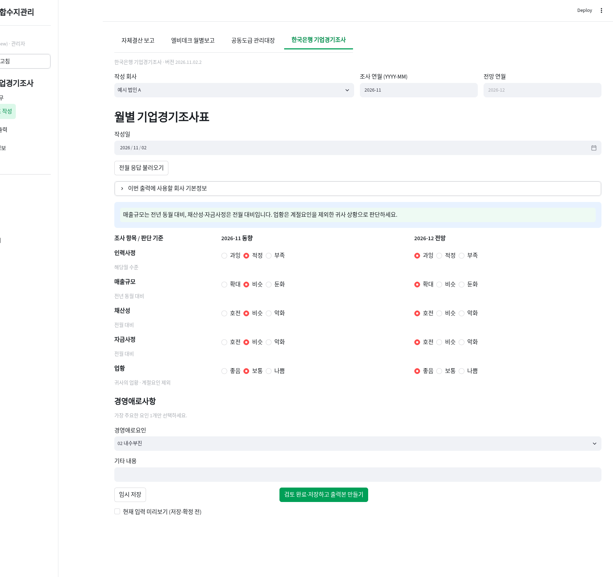
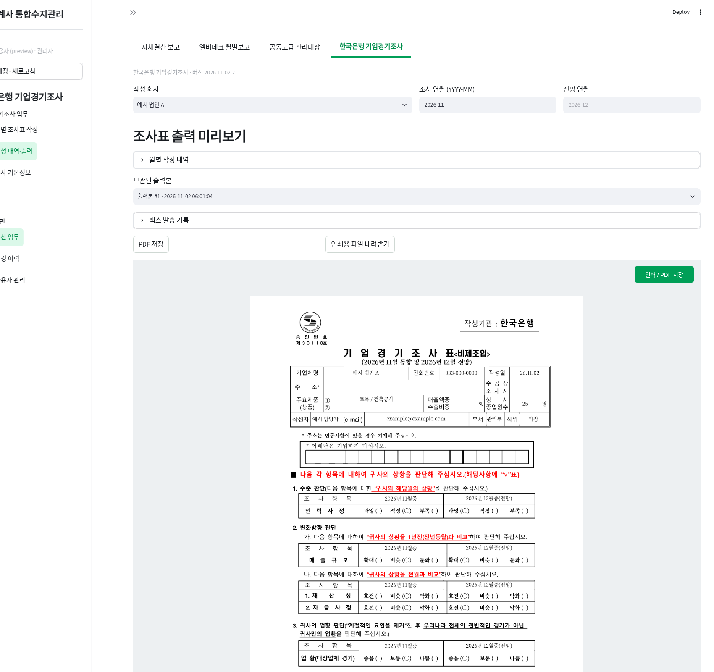

# 한국은행 기업경기조사 · 2026.11.02.2

상단 프로그램 선택에 **한국은행 기업경기조사**를 추가했습니다. (주)효성과 다혜건설(주)의 기본정보와 월별 응답은 별도로 저장합니다. 모든 로그인 사용자가 작성·수정할 수 있으며 변경 이력과 자동 백업은 기존 공동 사용 방식으로 기록합니다. 작업 화면 메뉴는 왼쪽 하단에 유지합니다.

## 처음 사용

기존 서버 실행 창을 종료하고 새 ZIP을 압축 해제합니다. 새 폴더의 **프로그램_업데이트.bat → Enter → 기존 폴더의 start.bat 선택** 후 기존 start.bat으로 재실행합니다. `upgrade.bat`을 다시 실행할 필요가 없습니다. 기존 자체결산·월별보고·공동도급 자료와 계정은 유지됩니다.

1. 상단 **한국은행 기업경기조사 → 회사 기본정보**를 엽니다.
2. 작성 회사를 선택하고 기업체명·전화번호·주소·주공장 소재지·주요제품 두 칸·수출비중·상시 종업원수·작성자·이메일·부서·직위·수신 팩스번호를 회사별로 저장합니다. 개인 연락처와 기존 실제 응답은 공개 배포본에 포함하지 않았으므로 최초 1회 등록합니다. 원본의 공공 문의처는 한국은행 강릉본부이며 기본 수신 팩스번호는 033-640-0165입니다. 발송 전 해당 회사 수신처와 일치하는지 확인하세요.
3. **월별 조사표 작성**에서 회사와 조사 연월(YYYY-MM)을 선택합니다. 전망은 익월로 자동 설정하며 12월의 다음 해 1월도 처리합니다.
4. 작성일, 당월 동향 5개, 익월 전망 5개, 경영애로요인 1개를 선택합니다. 신규 작성은 미응답 상태입니다. 기타는 출력 칸에 맞게 18자 이내로 입력합니다.
5. 작성 중에는 **임시 저장**을 사용합니다. **전월 응답 불러오기**는 화면의 응답을 전월 값으로 바꾸므로 이번 달 상황을 검토한 뒤 저장하세요. 자동 확정하지 않습니다.
6. **검토 완료·저장하고 출력본 만들기**를 누르면 저장과 함께 출력본을 보관합니다. 모든 응답과 기업체명·전화번호·작성자가 필요합니다. PDF 또는 인쇄용 HTML을 받거나 미리보기 안의 인쇄 버튼을 누릅니다.

매출규모는 전년 동월, 채산성·자금사정은 전월과 비교합니다. 업황은 전체 경제가 아니라 계절적 요인을 제외한 귀사 상황입니다. 회계원장으로 응답을 자동 확정하지 않습니다.

## 원본 그대로 출력

제공된 PDF에서 회사정보·조사월·작성일·응답만 비운 300dpi 양식 이미지를 사용합니다. 원본의 로고·안내문·표·문구·문의처 배치를 유지하고 지정 칸에 값을 넣습니다. 기관 기입란은 비워 둡니다. 다른 회사의 응답이나 기관 코드를 자동으로 복사하지 않습니다.

PDF는 A4 한 장, 300dpi로 생성하며 한글 글꼴은 Windows 맑은 고딕(서버 Linux는 Noto CJK)을 사용합니다. 한글 글꼴이 없으면 설치 안내를 표시합니다. 브라우저와 무관하게 PDF를 서버에서 생성하므로 출력 권장은 **PDF 저장 → PDF 열기 → A4·실제 크기(100%)**입니다. HTML 인쇄는 브라우저 머리글·바닥글을 끄고 A4로 출력합니다. 긴 회사정보는 칸에 맞게 축소되며 너무 길면 줄여달라는 안내가 나옵니다.

## 보관본·두 회사 출력

**작성 내역·출력**의 상단에서 회사·조사월을 선택합니다. 월별 작성 내역을 펼쳐 저장 상태를 확인하고 해당월 출력본을 선택해 다시 내려받습니다. 수정 후에는 새 출력본을 만드세요. 과거 PDF와 작성 당시 회사정보·응답은 보존됩니다. 수정 후 재출력하지 않은 월은 **수정 후 재출력 필요**로 표시합니다.

두 회사 모두 선택 월의 최신 응답에 맞는 출력본이 있으면 **두 회사 인쇄용 파일**이 활성화됩니다. 파일을 열면 회사별 한 장씩, 총 두 장을 인쇄합니다.

회사 기본정보 변경은 과거 조사표·출력본을 자동 변경하지 않습니다. 해당월을 다시 저장하고 새 출력본을 만들면 최신 기본정보가 반영됩니다.

## 팩스 발송 기록

팩스를 직접 보낸 후 **작성 내역·출력 → 출력본 선택 → 팩스 발송 기록**에서 실제 발송일·수신번호·메모를 입력하고 결과 확인을 체크합니다. 기록은 선택 출력본에 연결됩니다. **자동 팩스 전송 기능은 없으며, 발송 기록은 서비스의 전송 성공 증명이 아닙니다.**

## 저장·보안

데이터는 기존 설치의 `data/business_survey.db`, 자동 백업은 `private/backups`에 저장합니다. 원본 PDF·개인 연락처·실제 응답은 공개 저장소에 게시하지 않았습니다. 공개 배포에는 개인정보를 제거한 빈 양식과 가상 검증 화면만 포함합니다. `변경 이력`에서 조사표 DB를 선택하면 수정 이력을 확인합니다.

